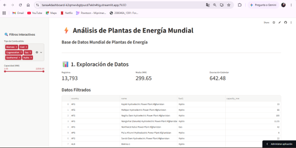

# Análisis de Plantas de Energía del Mundo
[![Streamlit App]https://tarea4dashboard-k2qmwvbgtpucd7ekln4tig.streamlit.app/

## 📝 Descripción del proyecto
Este proyecto presenta un análisis exploratorio de datos sobre la infraestructura de generación eléctrica a nivel mundial. Se examina información de más de 28,000 plantas de energía distribuidas en diferentes países. El objetivo es entender qué tipos de energía se utilizan con mayor frecuencia, cuál es su capacidad de producción y qué patrones existen en la forma en que el mundo genera su electricidad. Para este estudio se utilizó la Base de Datos Mundial de Plantas de Energía, ya que ofrece una cobertura amplia y detallada que permite comparar distintas regiones y fuentes de energía.

## 🌐 Dashboard publicado
🔗 *Acceder al dashboard:* [https://tarea4dashboard-k2qmwvbgtpucd7ekln4tig.streamlit.app/]


## 🔍 Hallazgos principales del análisis
- Las energías renovables como la hidroeléctrica, la solar y la eólica son las más numerosas en el mundo, lo que muestra una transición hacia fuentes más limpias.
- Las plantas que utilizan carbón o energía nuclear, aunque son menos, tienen una capacidad de producción considerablemente mayor en promedio.
- La mayoría de las plantas de energía son de tamaño pequeño o mediano; las instalaciones de gran escala son menos frecuentes.

## 🛠️ Instrucciones de instalación y ejecución local

### Paso 1: Requisitos previos
- Tener Python instalado en tu computadora

### Paso 2: Descargar el proyecto
Clona o descarga los siguientes archivos en una carpeta:
- app.py
- global_power_plant_database.csv
- requirements.txt

### Paso 3: Instalar las librerías
Abre la terminal en esa carpeta y ejecuta:
```bash
pip install -r requirements.txt

Información del estudiante

*Nombre:* Sindy Dayana Forero Ortega
*Universidad:* Universidad Nacional Abierta y a Distancia — UNAD
*Curso:* Programación para el analisís de datos
*Fecha:* 06 de Diciembre de 2026
